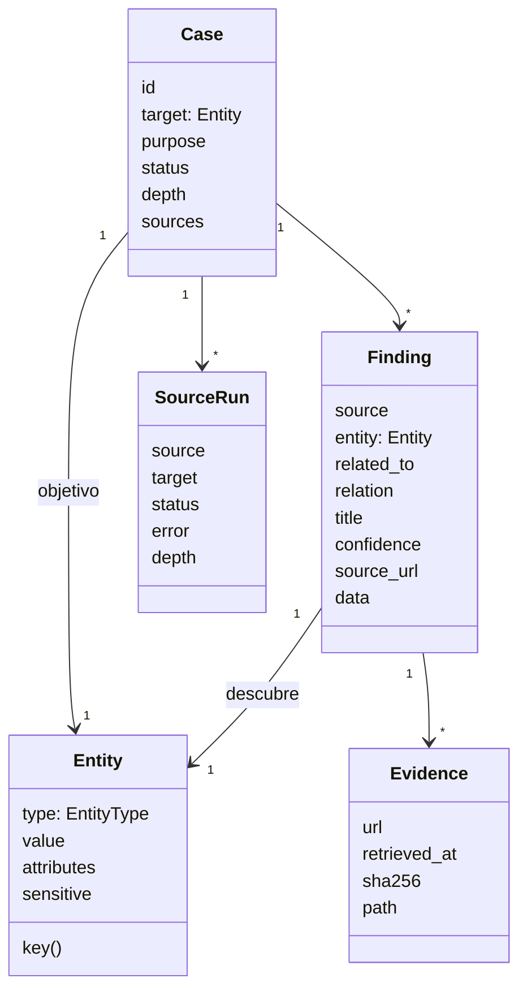
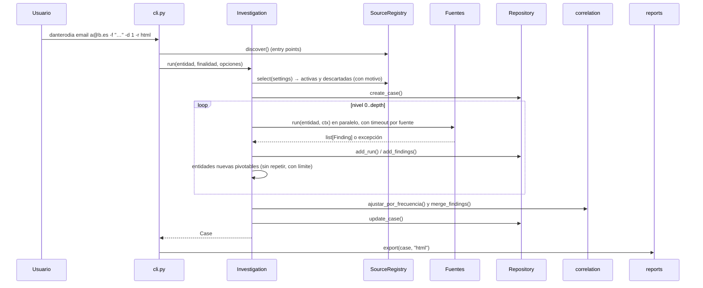

# Arquitectura de danterodia

Este documento explica cómo está organizado el código y qué pasa desde que escribes
`danterodia persona …` hasta que sale el informe. Para escribir una fuente nueva, ve
directamente a [CREAR_PLUGIN.md](CREAR_PLUGIN.md).

## Principios

1. **Fuentes oficiales y datos abiertos primero.** Solo se hace scraping donde no hay
   alternativa, con un User-Agent propio, a ritmo limitado y con la opción de desactivarlo.
2. **Nada activo contra terceros**: ni inicios de sesión, ni formularios de reseteo, ni
   sondeo SMTP, ni pruebas de credenciales.
3. **Fallar sin romper.** Si una fuente falla, se registra el error y se sigue con las demás.
4. **Trazabilidad.** Cada dato lleva su fuente, URL, fecha UTC, confianza y, si procede, una
   evidencia con hash.
5. **Privacidad por diseño.** Finalidad obligatoria, fuentes sensibles desactivadas por
   defecto, casos que caducan y se pueden borrar.
6. **Sin estado global.** Todo se inyecta (configuración, HTTP, DNS, almacenamiento), y por
   eso los tests no necesitan Internet.

## Mapa del código

```text
src/danterodia/
├── cli.py               Comandos (Typer + Rich). Solo traduce opciones y muestra resultados.
├── config.py            Settings (pydantic-settings): CLI > DANTERODIA_* > .env > valores por defecto.
├── models.py            Entity, Finding, Evidence, SourceRun, Case (Pydantic v2).
├── http.py              HttpClient: timeouts, reintentos, límite por dominio, caché, anti-SSRF, Tor.
├── dnsutil.py           Resolvedor DNS asíncrono (dnspython), sustituible en tests.
├── search.py            Buscadores: DuckDuckGo (ddgs), Brave, Google CSE y Mojeek API.
├── identifiers.py       CIF/DNI/NIE, normalización y comparación de nombres.
├── logs.py              Consola Rich y log JSONL por caso.
├── sources/             Las fuentes (plugins). base.py define la interfaz y el registro.
├── investigations/      Orquestador: ejecución en paralelo, pivoting, reanudación.
├── correlation/         Deduplicación, confianza combinada, ajuste por frecuencia y grafo.
├── reports/             Exportadores (HTML, JSON, CSV, MD, GEXF, GraphML, Maltego).
├── evidence/            Evidencias en disco con SHA-256.
├── storage/             Repositorio de casos: SQLite (por defecto) y MongoDB (opcional).
├── indices/             Índice local FTS5 (BOE, BORME, PLACSP, indultos, PDFs) y sus constructores.
└── data/                Datos empaquetados: INE, Civio, WhatsMyName, dorks, prensa, vis-network.
```

Fuera del paquete:

- `Buscador*.py` (raíz): envoltorios de compatibilidad con el original. Llaman a
  `cli.legacy_main`.
- `legacy/`: el código original, solo como referencia; no se importa nunca.
- `data/`: datasets del repositorio original, que `danterodia indice locales` importa al
  índice local.

## Modelo de datos

Todo lo que sale de una fuente es un `Finding` que apunta a una `Entity`. Así el
orquestador, la correlación y los informes no necesitan saber nada de cada fuente.



- **`EntityType`**: `persona`, `email`, `telefono`, `username`, `dominio`, `ip`, `empresa`,
  `url` y `documento`.
- **`Entity.key`** es `tipo:valor_normalizado` (sin tildes, en minúsculas, teléfono solo
  con dígitos…). Es lo que se usa para deduplicar: «José PÉREZ» y «jose perez» son la misma
  entidad.
- **`Finding.related_to`** es la clave de la entidad investigada que llevó al hallazgo, y
  `relation` el tipo de relación (`tiene_cuenta`, `cargo_en`, `mismo_alias`…). Con estos dos
  campos se construye el grafo.
- **`SourceRun.status`**: `ok`, `sin_resultados`, `omitida`, `error` o `timeout`.
- **`Case.status`**: `en_curso`, `terminado` o `parcial` (terminó, pero alguna fuente falló).

## Qué pasa en una investigación



Paso a paso:

1. **Selección de fuentes** (`SourceRegistry.select`). Se descartan, con su motivo, las que
   están desactivadas en la configuración, las sensibles (si no se han pedido) y las que
   necesitan una clave que falta. Las descartadas que aceptan el tipo del objetivo quedan
   registradas como `omitida`, para que el informe diga por qué no se usaron.
2. **Ejecución** (`Investigation._nivel`). Todas las fuentes que aceptan cada entidad se
   lanzan a la vez con `asyncio.gather`. Cada una tiene su propio límite de tiempo
   (`Source.timeout` o `DANTERODIA_SOURCE_TIMEOUT`).
3. **Errores** (`Investigation._una`). Una excepción nunca tumba el caso:
   - `SourceSkipped` → `omitida`, con el motivo (por ejemplo, «índice vacío: ejecuta…»).
   - `HttpError` → `error`, con el detalle de red.
   - `TimeoutError` → `timeout`.
   - Cualquier otra → `error`, con la traza completa en el log del caso.
4. **Pivoting** (`Investigation._siguientes`). Si `depth > 0`, las entidades descubiertas
   de tipo email, nick, dominio, teléfono, empresa o IP se investigan en el nivel siguiente.
   Hace falta que no sean sensibles, que la confianza sea de al menos 0,5 y que no se hayan
   visto antes. Hay un máximo total de `DANTERODIA_MAX_PIVOT_ENTITIES`.
5. **Correlación** (`correlation`):
   - `ajustar_por_frecuencia`: los hallazgos que coinciden **solo por el nombre** se
     multiplican por `1 / (1 + log10(N))`, donde N es el número de personas con ese nombre
     según el INE. El valor original y el motivo quedan en `Finding.data`.
   - `merge_findings`: une los hallazgos sobre la misma relación. Si vienen de fuentes
     distintas, la confianza se combina con la regla «o ruidoso», `1 − Π(1 − cᵢ)`. Si vienen
     de la misma fuente, se queda el de mayor confianza.
6. **Persistencia.** En la base de datos se guardan los hallazgos **en bruto** a medida que
   llegan; la deduplicación se rehace al leer, así que es reproducible.
7. **Informes.** El CLI exporta el caso en los formatos pedidos.

**Retomar un caso** (`Investigation.resume`) recorre otra vez el árbol desde el objetivo,
pero se salta las parejas (fuente, entidad) que ya terminaron en `ok` o `sin_resultados`.
Solo repite lo que falló, se agotó o no llegó a ejecutarse.

## Red: `HttpClient`

Todas las fuentes usan el mismo cliente, que llega en `ctx.http`. Ninguna fuente crea su
propio `httpx.AsyncClient`. Así las protecciones se aplican siempre:

| Protección | Cómo |
|---|---|
| Timeouts | `DANTERODIA_TIMEOUT` por defecto; una fuente puede pedir uno menor por petición. |
| Reintentos | En errores de transporte y en 429/500/502/503/504, con espera exponencial y *jitter*. Respeta `Retry-After` (hasta 120 s). |
| Ritmo | Semáforo global (`MAX_CONCURRENCY`) y, por dominio, concurrencia máxima e intervalo mínimo entre peticiones. |
| Caché | SQLite en `DATA_DIR/cache.sqlite`, solo para GET y para códigos cacheables (200, 404, 410…). TTL configurable y por petición. |
| Anti-SSRF | Solo `http`/`https`. Se resuelve el host y se rechaza si alguna IP es privada, local o reservada. Las redirecciones se siguen a mano y **cada salto** se vuelve a comprobar. |
| Tamaño | La respuesta se lee en streaming y se corta al superar `MAX_RESPONSE_BYTES` (20 MB). |
| TLS | Siempre verificado, con un contexto compartido basado en `certifi`. |
| Tor | Las `.onion` van por un cliente aparte con `DANTERODIA_TOR_PROXY`; el resto del tráfico nunca pasa por él. |

`HttpClient.request` no lanza excepción por un 4xx o 5xx final: devuelve `HttpResponse` y
la fuente decide (un 404 suele significar «no existe», que es un resultado). Solo lanza
`HttpError` cuando no hay respuesta posible: red caída, URL bloqueada o respuesta demasiado
grande.

## Almacenamiento

`storage.base.Repository` es un `Protocol` con nueve métodos (`create_case`, `update_case`,
`add_findings`, `add_run`, `get_case`, `list_cases`, `delete_case`, `expired_cases` y
`close`). Hay dos implementaciones que pasan **los mismos tests de contrato**:

- `SQLiteRepository` (SQLModel): un único fichero, `DATA_DIR/danterodia.db`. Es la opción
  por defecto.
- `MongoRepository` (extra `[mongo]`): se activa con `DANTERODIA_DATABASE_URL=mongodb://…`.
  Sirve para compartir casos entre varios equipos.

`open_repository(url)` elige la implementación según el esquema de la URL. Las fechas se
guardan siempre en UTC.

En el disco, fuera de la base de datos:

```text
DATA_DIR/
├── danterodia.db          casos, hallazgos y ejecuciones
├── cache.sqlite           caché HTTP
├── indices.sqlite         índice local FTS5
├── wmn-data.json          WhatsMyName actualizado (opcional, con `actualizar-wmn`)
├── dorks.toml             tus dorks (opcional)
└── casos/<id>/
    ├── caso.log.jsonl     log estructurado del caso
    └── evidencias/
        ├── <sha256>.html  copia en bruto
        └── <sha256>.html.json   URL, fecha UTC, tipo y tamaño
```

Las evidencias se nombran por su hash, así que el mismo contenido no se duplica y
cualquiera puede comprobar su integridad (`EvidenceStore.verify`).

## Índice local

La API del BOE solo devuelve el sumario de un día o un documento concreto: no busca por
nombre. Por eso `boe`, `borme`, `contratacion`, `indultos` y `documentos_locales` consultan
`indices.sqlite`, que se construye con `danterodia indice …` (`indices/builders.py`).

- Cada tabla tiene su tabla virtual FTS5 con `remove_diacritics`, así que la búsqueda no
  distingue tildes. Después se filtra con `identifiers.coincide_nombre` para exigir que
  estén todos los términos del nombre.
- Los constructores son **incrementales**: guardan en `meta` qué días o páginas ya tienen y
  no los repiten. `indultos` se puede interrumpir y reanudar.
- El BORME se lee de la **versión XML** de la sección A (nombramientos, ceses…), mucho más
  fiable que el texto de los PDF.
- Si el índice no existe o la tabla está vacía, la fuente lanza `SourceSkipped` con el
  comando que hay que ejecutar.

## Informes

`reports.export(case, fmt, carpeta)` escribe `caso-<id>.<ext>`. Los exportadores son
funciones puras `Case → str` registradas en `EXPORTERS`:

- **HTML**: plantilla Jinja2 (`reports/templates/informe.html.j2`) con **autoescape**, de
  modo que el texto que viene de webs de terceros no puede ejecutar código en el informe.
  Lleva vis-network embebido (sin CDN), así que se abre sin conexión.
- **JSON**: `schema_version`, generador, fecha y el caso con los hallazgos deduplicados. El
  esquema completo sale de `danterodia esquema` (`Case.model_json_schema()`).
- **CSV**: las celdas que empiezan por `=`, `+`, `-`, `@`, tabulador o retorno de carro
  llevan delante un apóstrofo, para que Excel o LibreOffice no las ejecuten como fórmulas.
- **GEXF / GraphML**: el grafo de `correlation.build_graph` (networkx).
- **Maltego**: CSV de pares de entidades importable en Maltego.

## Configuración

`config.Settings` (pydantic-settings) reúne todas las opciones con su tipo y validación.
Las claves de API son `SecretStr`: no aparecen en los logs ni en `danterodia config`, que
muestra «configurada» o «vacía». Una fuente pide su clave con
`ctx.settings.api_key("nombre_del_campo")`, que devuelve `None` si no está.

## Tests

- `tests/conftest.py` aísla cada test: borra las variables `DANTERODIA_*`, cambia a una
  carpeta temporal y sustituye el resolvedor DNS, el DNS de dnspython y DuckDuckGo por
  versiones falsas.
- Las peticiones HTTP se simulan con `respx`, que **falla** si una petición no está
  simulada. Ningún test sale a Internet.
- Las respuestas reales grabadas (recortadas) están en `tests/fixtures/`.
- El test de MongoDB real solo se ejecuta si existe `TEST_MONGO_URL`; en la CI se ejecuta
  contra un MongoDB 7.

## Decisiones técnicas

Las decisiones (por qué uv, httpx, SQLite + FTS5, Typer, Jinja2…) y su motivo están en
[PLAN.md §2](PLAN.md). Lo que cambió respecto al original, y por qué, está en el
[CHANGELOG](../CHANGELOG.md).
